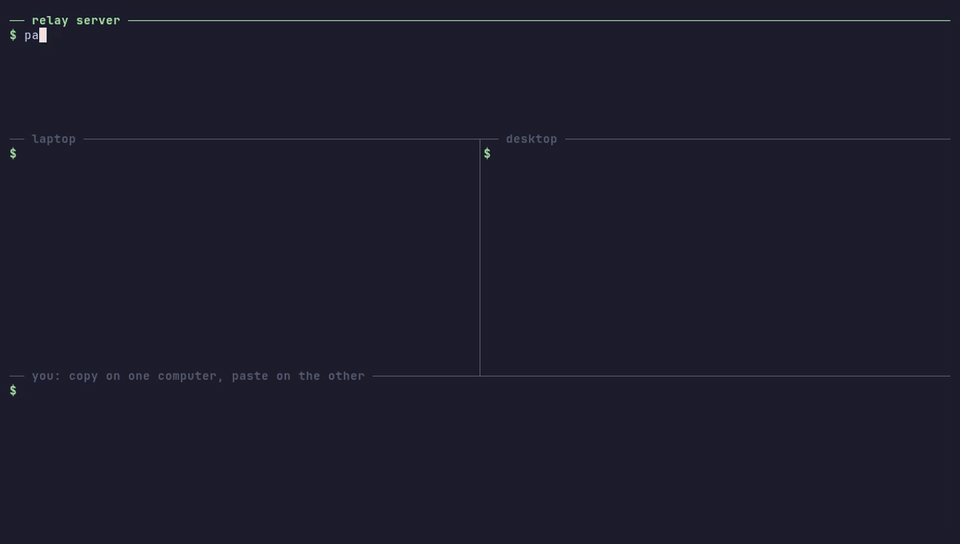

<p align="center">
  <picture>
    <source media="(prefers-color-scheme: dark)" srcset="assets/logo-animated-dark.svg">
    
  </picture>
</p>

<h1 align="center">panosync</h1>

<p align="center"><b>Copy on one computer, paste on another. End-to-end encrypted.</b></p>

<p align="center">
  <a href="https://github.com/msbayindir/panosync/actions/workflows/ci.yml"></a>
  <a href="https://github.com/msbayindir/panosync/releases/latest"></a>
  <a href="#license"></a>
  
</p>

<p align="center"><b>English</b> · <a href="README.tr.md">Türkçe</a> · <a href="https://msbayindir.github.io/panosync/">Website</a></p>

<p align="center"></p>
<p align="center"><sub>Terminal recording made with <a href="docs/demo.md">VHS</a>: a local relay and two clients with separate clipboards.</sub></p>

```bash
brew install msbayindir/tap/panosync      # macOS and Linux; or, without Homebrew:
curl -fsSL https://raw.githubusercontent.com/msbayindir/panosync/main/install.sh | sh
```

**panosync** keeps the clipboard in sync between your macOS, Linux and Windows machines, even when they are
on different networks. Everything is end-to-end encrypted on your devices; the small relay server you host
in between only forwards bytes it cannot read.

- **One small binary per side.** The client is a single 3.1–4.5 MB executable with no runtime; the relay is about 1.4 MB.
- **Self-hosted relay in one step.** A Dockerfile that Coolify (or any Docker host) builds as-is, or a prebuilt image on `ghcr.io`.
- **No accounts, no web UI.** One command on the first device prints the one command to run on the others.
- **Text only, on purpose.** Copy on one machine, paste on another. That's it.

**Contents:** [How it works](#how-it-works) · [Quick start](#quick-start) · [Commands](#commands) ·
[Security model](#security-model) · [Compared to alternatives](#compared-to-alternatives) ·
[Troubleshooting](#troubleshooting) · [Development](#development) · [License](#license)

## How it works

```
   macOS                          relay (your server)                     Ubuntu
 ┌───────────────┐   wss://      ┌─────────────────────┐   wss://      ┌───────────────┐
 │ Cmd+C         │               │                     │               │               │
 │ encrypt with  │ ────────────► │ forwards ciphertext │ ────────────► │ decrypt,      │
 │ your key      │               │ to the other devices│               │ write to the  │
 │               │ ◄──────────── │ on the same channel │ ◄──────────── │ clipboard     │
 └───────────────┘               │                     │               └───────────────┘
                                 │ sees: IPs, timing,  │
     Windows ◄─────────────────► │ message sizes       │
                                 │ never: the key or   │
                                 │ the text            │
                                 └─────────────────────┘
```

1. `panosync setup` on the first device generates a random 32-byte key.
2. From that key, each device derives (with BLAKE3) an **encryption key** and a separate **channel id**.
3. Devices connect to the relay at `/ws?channel=<channel id>`.
   The relay groups connections by channel id and forwards each message to the other devices in it.
4. Every message is encrypted with XChaCha20-Poly1305 before it leaves the device.

The full protocol and threat model are in [docs/architecture.md](docs/architecture.md).

There are two programs:

| Program | Runs on | Does |
|---|---|---|
| `panosync` | your macOS / Linux / Windows machines | watches the clipboard, encrypts and sends changes, writes incoming text to the clipboard |
| `panosync-relay` | a server (Docker, Coolify, any VPS) | the relay |

## Quick start

You need a relay reachable over `wss://` (WebSocket over TLS) and the client on each machine.

### 1. Run the relay

The relay speaks plain `ws://` on port 8080 and expects a reverse proxy in front of it for TLS.
The short version is below; [docs/self-hosting.md](docs/self-hosting.md) covers Coolify, Docker, systemd,
Caddy, nginx and local-network-only setups in detail, with what each was tested with.

**Coolify** (TLS is handled for you)

1. Fork this repository (or point Coolify at it directly) and create a new resource from it.
2. **Build Pack:** `Dockerfile` · **Ports Exposes:** `8080` · **Domains:** `https://panosync.example.com`
3. Deploy, then open `https://panosync.example.com/health`. It should answer `ok`.

No domain? Coolify's `sslip.io` addresses work too (e.g. `https://panosync.1.2.3.4.sslip.io`).

**Docker**

```bash
docker run -d --name panosync-relay --restart unless-stopped -p 8080:8080 ghcr.io/msbayindir/panosync-relay:latest
```

Put any TLS reverse proxy in front of it. With [Caddy](https://caddyserver.com), the whole config is:

```
panosync.example.com {
    reverse_proxy localhost:8080
}
```

For nginx, the WebSocket `Upgrade` headers are required; see [docs/self-hosting.md](docs/self-hosting.md#https-with-nginx).

**From source:** `cargo run --release -p panosync-relay` (set `PORT` to change the port).

### 2. Install the client

**Homebrew (macOS and Linux)**

```bash
brew install msbayindir/tap/panosync
```

The formula installs the same prebuilt binaries as the release page, and `brew services start panosync`
starts panosync at login.

**Install script (macOS and Linux)**

```bash
curl -fsSL https://raw.githubusercontent.com/msbayindir/panosync/main/install.sh | sh
```

The script picks the right binary for your OS and CPU, checks its SHA-256 against the release's
`SHA256SUMS`, and installs it to `~/.local/bin` (override with `PANOSYNC_INSTALL_DIR=/usr/local/bin`,
pin a version with `PANOSYNC_VERSION=v0.1.0`). Read it first if you like: [install.sh](install.sh).

**Windows:** download `panosync-x86_64-pc-windows-msvc.zip` from the
[latest release](https://github.com/msbayindir/panosync/releases/latest), unzip it and put `panosync.exe` somewhere on your `PATH`.

**Manual download:** every release has archives for `aarch64-apple-darwin`, `x86_64-apple-darwin`,
`x86_64-unknown-linux-gnu`, `aarch64-unknown-linux-gnu` and `x86_64-pc-windows-msvc`, plus `SHA256SUMS`.
The binaries are not code-signed. On macOS, if you downloaded with a browser, clear the quarantine flag once:
`xattr -d com.apple.quarantine ./panosync`.

**cargo-binstall:** `cargo binstall --git https://github.com/msbayindir/panosync panosync` downloads the
prebuilt binary for your platform from the release (panosync is not on crates.io, hence `--git`).

**From source:** `cargo install --git https://github.com/msbayindir/panosync panosync` (Rust 1.88+).

### 3. Pair your devices

On the **first** device, run setup without a key. A new key is generated:

```bash
panosync setup --server wss://panosync.example.com
```

It prints the exact command to run on every **other** device:

```bash
panosync setup --server wss://panosync.example.com --key <your key>
```

> Anyone with this key can read your clipboard. Move it with something like
> [croc](https://github.com/schollz/croc), [LocalSend](https://localsend.org) or by typing it, not
> through chat or email. `panosync key` prints it again later.

### 4. Run it

```bash
panosync
```

Copy something on one machine and paste it on another. The log shows `sent (26 bytes)` and
`received (26 bytes)`. **The clipboard contents are never written to the log, only their length.**

**Start at login**

- **Homebrew (macOS and Linux):** `brew services start panosync`.
- **Linux (systemd):** see the steps at the top of [packaging/panosync.service](packaging/panosync.service).
- **macOS (launchd):** see the steps at the top of [packaging/com.msbayindir.panosync.plist](packaging/com.msbayindir.panosync.plist).
- **Windows:** press <kbd>Win</kbd>+<kbd>R</kbd>, run `shell:startup` and put a shortcut to `panosync.exe` in that folder.

## Commands

| Command | Turkish alias | What it does |
|---|---|---|
| `panosync` / `panosync start` | `baslat` | Start syncing |
| `panosync setup --server <url> [--key <key>]` | `kurulum --sunucu … --anahtar …` | Configure this device; without `--key`, generates a new key |
| `panosync key` | `anahtar` | Print the key, to add another device |
| `panosync config` | `ayar` | Print the path of the config file |
| `panosync pause <minutes>` | `duraklat` | The running client stops sending clipboard changes for that long. `panosync pause 0` resumes |

`pause` is meant for moments like copying a password: text copied while paused is never sent, not even
after the pause ends. Incoming text from other devices is still applied. The end time is stored in a
`paused_until` file next to the config file, so the command works whether or not `panosync` is running.

The config directory is `~/.config/panosync` on Linux, `~/Library/Application Support/panosync` on
macOS and `%APPDATA%\panosync` on Windows. Set `PANOSYNC_CONFIG_DIR` to use another one (for example to
run two clients on one machine).

Set `RUST_LOG=debug` for verbose logs.

## Security model

**What is protected**

- **Confidentiality and integrity of the text.** Each message is encrypted with XChaCha20-Poly1305
  (random 24-byte nonce) using a key that never leaves your devices. A modified, truncated or
  wrongly-keyed message is rejected.
- **The relay never learns the key.** The encryption key and the channel id are derived from your key
  with BLAKE3 in separate contexts, so the channel id the relay sees reveals nothing about the encryption key,
  and nobody can guess a channel id without your key.
- **Replays.** Messages carry a random id and a timestamp; repeated ids and messages older than
  5 minutes are rejected.
- **Transport.** Connections use TLS (`wss://`) on top of the end-to-end encryption.
- **Config file.** On macOS and Linux the key file is created with mode `600` (only your user can read it).
- **Abuse limits on the relay.** 1 MB per message, 16 devices per channel, 50 messages per 10 seconds per connection.

**Known limitations**

- **The relay sees metadata.** It cannot read your clipboard, but it can see the IP addresses that
  connect, when messages are sent, and their approximate size (so roughly how long the copied text is).
  It also sees the channel id, which stays the same over time and links your devices together.
- **One shared key, no forward secrecy.** All devices share a single static key. If one device is
  compromised, all past traffic someone recorded and all future traffic can be decrypted, and there is no
  per-device revocation: generate a new key with `panosync setup --server …` and set up every device again.
- **Passwords sync too.** Anything you copy, including from a password manager, goes to your other
  devices (encrypted). There is no detection of password-manager copies yet; use
  `panosync pause <minutes>` or stop `panosync` when you don't want that.
- **The relay controls delivery.** A malicious relay can drop or delay messages, and within the
  5-minute window it could replay a recent message to a device that has restarted since (the list of seen
  message ids lives in memory).
- **Clocks must be roughly right.** Messages from a device whose clock is more than 5 minutes off are rejected.
- **Text only.** No images or files, and text over 512 KB is not sent.

**Windows note.** panosync does not set file permissions itself on Windows. The config file is stored at
`%APPDATA%\panosync\config.toml`, which by default inherits your user profile's permissions (your account,
SYSTEM and Administrators). Check it with `icacls "%APPDATA%\panosync\config.toml"`. `%APPDATA%` is the
*roaming* profile, so on a domain-joined machine with roaming profiles the key may be copied to the
domain's profile server; avoid that setup, or treat the key as known to its administrators.

Found a vulnerability? See [SECURITY.md](SECURITY.md).

## Compared to alternatives

panosync does one thing. Other tools do a lot more, and one of them may fit you better.
[ClipCascade](https://github.com/Sathvik-Rao/ClipCascade) in particular is a more complete, more
mature project with many more features.

| | panosync | ClipCascade | KDE Connect | Apple Universal Clipboard |
|---|---|---|---|---|
| Platforms | macOS, Linux, Windows | Windows, macOS, Linux (GUI and CLI), **Android**; iOS is on its to-do list | Linux, Windows, macOS, **Android, iOS**, Plasma Mobile, SailfishOS | Mac, iPhone, iPad, Apple Vision Pro |
| Content | text only | **text, images and files** | clipboard is one of many features (file sharing, notification sync, a virtual touchpad, …) | text, images, photos, videos, files |
| Across networks | yes, through your relay | yes, through its server; optional **peer-to-peer mode** (the server then only handles sign-in and signalling) | devices talk directly on the local network; VPNs for other cases | devices must be near each other, with Bluetooth, Wi-Fi and Handoff on |
| What you run | one stateless relay binary or container, configured by one variable (`PORT`) | a Java 21 server (JAR or Docker image) with user accounts, a web dashboard and a database volume; a free community server is also offered | nothing | nothing |
| Identity | one shared key, no accounts | username and password, several users per server | pairing between devices | the same Apple Account |
| Encryption | end-to-end, always on | end-to-end, on by default | TLS between devices | (not covered here) |
| Extras | `pause` command | per-device send/receive direction, notifications, settings UI | many plugins | built into the OS |
| License | MIT OR Apache-2.0 | GPL-3.0 | GPL-2.0 / GPL-3.0 | proprietary |

What panosync offers instead is mainly **size and simplicity**:

- **Lightweight:** the client is a single binary of 3.1–4.5 MB and the relay about 1.4 MB (v0.1.0 release
  binaries: 3.1 MB on macOS arm64, 3.5 MB on macOS Intel, 3.8 MB on Linux arm64, 4.0 MB on Windows and
  4.5 MB on Linux x86_64; downloads are 1.6–2.1 MB compressed), with no runtime, database or configuration
  beyond the key.
- **Easy to self-host:** the relay is one Dockerfile that Coolify builds as-is, or one `docker run`, or one
  systemd unit. It keeps no state, so there is nothing to back up or migrate.
- **Simple to use:** no accounts and no settings screens; `panosync setup` on the first device prints the
  one command for the others.
- **Small enough to audit:** the protocol fits on [one page](docs/architecture.md).

**Choose ClipCascade** if you need Android, images or files, a GUI, or several users on one server.
**Choose KDE Connect** if your devices share a network and you also want phone integration.
**Use Universal Clipboard** if all your devices are Apple devices.
**Choose panosync** if you want text sync between desktops on different networks with a relay you host
yourself and can read in an afternoon.

Sources, checked in November 2026: the [ClipCascade README](https://github.com/Sathvik-Rao/ClipCascade)
(v3.5.1), the [KDE Connect README](https://invent.kde.org/network/kdeconnect-kde) and
[download page](https://kdeconnect.kde.org/download.html), and Apple's
[Universal Clipboard support article](https://support.apple.com/en-us/102430).

## Troubleshooting

**Nothing arrives / cannot connect**
- Does `https://<your relay>/health` return `ok`?
- Does the address start with `wss://`? (`ws://` works only without TLS, e.g. for local testing.)
- Are the clocks on both machines synced automatically?
- Run with `RUST_LOG=debug panosync`.

**Linux (Wayland):** panosync uses the Wayland data-control protocol where the compositor supports it and
falls back to XWayland otherwise. It has been tested on Ubuntu with GNOME on Wayland (via XWayland). If copying or pasting doesn't
work, please open an issue with your distribution, desktop and the log output.

**macOS asks for permission:** depending on the macOS version you may be asked to allow clipboard
access for your terminal or for `panosync`. Allow it.

## Development

```bash
cargo test                       # all tests, including an end-to-end test against a real relay
cargo clippy --all-targets
cargo run -p panosync-relay      # local relay on port 8080
```

For local testing, set a client up with `--server ws://127.0.0.1:8080`.

```
client/src/main.rs        entry point: runs the chosen command
client/src/cli.rs         command-line definitions (English names, Turkish aliases)
client/src/config.rs      config directory and config.toml
client/src/clipboard.rs   clipboard polling, echo prevention, pause
client/src/net.rs         relay connection, keep-alive, reconnection
client/src/protocol.rs    v1 payload and checks on incoming messages
client/src/crypto.rs      key derivation and encryption
client/src/pause.rs       the pause state file
client/tests/             end-to-end test against a real relay, CLI tests
relay/src/                the relay (WebSocket fan-out, limits, /health)
packaging/                start-at-login files (systemd, launchd), Homebrew formula template
assets/                   logo, favicon, social preview
site/                     the GitHub Pages site
Dockerfile                relay image (used by Coolify and ghcr.io)
```

See [docs/architecture.md](docs/architecture.md) and [CONTRIBUTING.md](CONTRIBUTING.md).

## License

Licensed under either of [Apache License, Version 2.0](LICENSE-APACHE) or [MIT license](LICENSE-MIT) at your option.

Unless you explicitly state otherwise, any contribution intentionally submitted for inclusion in this
project by you, as defined in the Apache-2.0 license, shall be dual licensed as above, without any
additional terms or conditions.
