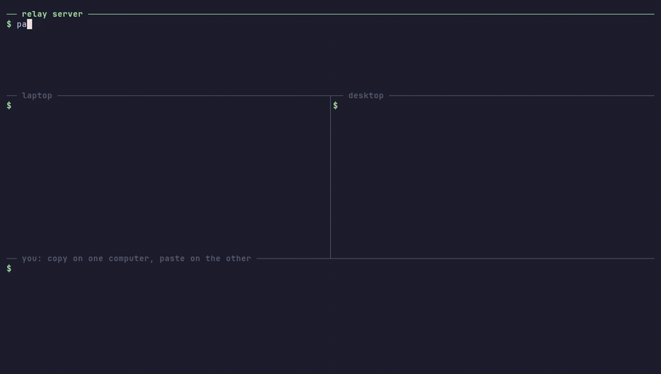

# panosync

> [English README](README.md). Ayrıntılı ve güncel belge İngilizce README'dir; bu sayfa kısa bir Türkçe özettir.
> Proje ilk sürümlerinde **pano** adını taşıyordu. O sürümler v1 protokolüyle konuşmaz.

**panosync**, macOS, Linux ve Windows bilgisayarların arasında panoyu (clipboard) senkronize eder;
cihazlar farklı ağlarda olabilir. Her şey cihazda uçtan uca şifrelenir, aradaki küçük aracı sunucu
sadece okuyamadığı baytları iletir.

<p align="center"></p>

```
   macOS                     aracı sunucu (senin sunucun)                Ubuntu
 [Cmd+C] → şifrele ──────►   sadece iletir, içeriği okuyamaz   ──────► şifreyi çöz → panoya yaz
```

| Program | Nerede çalışır | Ne yapar |
|---|---|---|
| `panosync` | Mac, Linux, Windows | panoyu izler, değişiklikleri şifreleyip gönderir, gelenleri panoya yazar |
| `panosync-relay` | sunucu (Coolify, Docker, VPS) | aynı kanaldaki cihazların arasında şifreli mesajları iletir |

## Kurulum

**1. Aracı sunucu.** Coolify'da bu depodan *Dockerfile* build pack'iyle bir kaynak oluştur, port `8080`,
alan adını ekle ve deploy et. `https://<alan adın>/health` adresi `ok` dönmeli. Docker ile:

```bash
docker run -d --name panosync-relay --restart unless-stopped -p 8080:8080 ghcr.io/msbayindir/panosync-relay:latest
```

TLS için önüne bir ters vekil (Caddy, nginx, Traefik) koy. Bütün seçenekler (Coolify, Docker, systemd, Caddy, nginx, sadece yerel ağ): [docs/self-hosting.md](docs/self-hosting.md).

**2. İstemci (Mac ve Linux).**

```bash
curl -fsSL https://raw.githubusercontent.com/msbayindir/panosync/main/install.sh | sh
```

Betik doğru binary'yi seçer, SHA-256 özetini doğrular ve `~/.local/bin` içine kurar.
Windows için [son sürümden](https://github.com/msbayindir/panosync/releases/latest) `.zip` dosyasını indir.

**3. Cihazları eşleştir.** İlk cihazda:

```bash
panosync setup --server wss://<alan adın>
```

Çıktıda diğer cihazlarda çalıştırılacak komut yazar (`panosync setup --server … --key …`).
Bu anahtarı bilen herkes panonu okuyabilir; sadece kendi cihazlarına güvenli bir yoldan aktar.

**4. Çalıştır.** Her cihazda `panosync`. Günlükte sadece bayt sayıları görünür (`sent (26 bytes)`), içerik hiçbir zaman yazılmaz.
Oturum açınca otomatik başlatmak için `packaging/` klasöründeki systemd ve launchd dosyalarının başındaki adımları izle.

## Komutlar

| Komut | Türkçe karşılığı | Ne yapar |
|---|---|---|
| `panosync` / `panosync start` | `baslat` | Senkronizasyonu başlatır |
| `panosync setup --server <url> [--key <anahtar>]` | `kurulum --sunucu … --anahtar …` | Cihazı ayarlar, anahtar verilmezse yenisini üretir |
| `panosync key` | `anahtar` | Anahtarı gösterir |
| `panosync config` | `ayar` | Ayar dosyasının yerini gösterir |
| `panosync pause <dakika>` | `duraklat` | Çalışan istemci o süre boyunca panoyu göndermez; `pause 0` devam ettirir |

Ayar klasörü: Linux'ta `~/.config/panosync`, macOS'ta `~/Library/Application Support/panosync`,
Windows'ta `%APPDATA%\panosync`. `PANOSYNC_CONFIG_DIR` ortam değişkeniyle değiştirilebilir.

## Güvenlik ve bilinen sınırlar

- İçerik XChaCha20-Poly1305 ile şifrelenir; anahtar cihazlardan hiç çıkmaz. Değiştirilmiş, tekrar
  gönderilmiş ya da 5 dakikadan eski mesajlar reddedilir.
- **Aracı sunucu içeriği göremez**, ama bağlanan IP'leri, mesajların zamanını ve yaklaşık boyutunu görebilir.
- **Tek ortak anahtar** var: bir cihaz ele geçirilirse yeni anahtar üretip bütün cihazları yeniden kurmak gerekir.
- **Parolalar da senkronize olur**; şifre yöneticisi algılaması henüz yok. Bunun için `panosync pause <dakika>` var.
- Sadece metin (en fazla 512 KB), sadece masaüstü.

Ayrıntılar: [docs/architecture.md](docs/architecture.md) ve [SECURITY.md](SECURITY.md).

## Lisans

MIT veya Apache-2.0, hangisini istersen.
